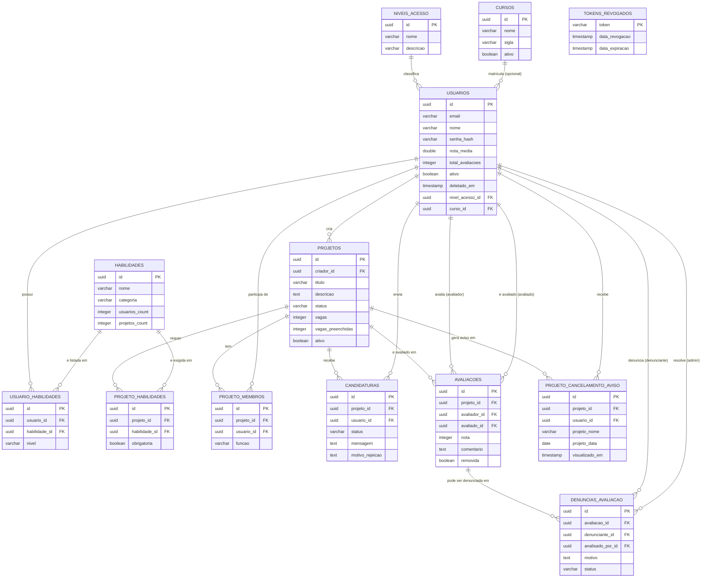
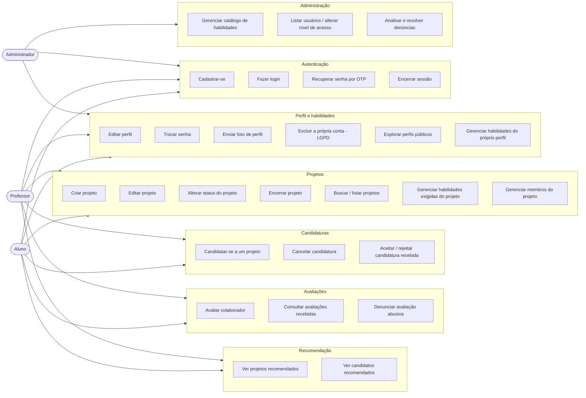
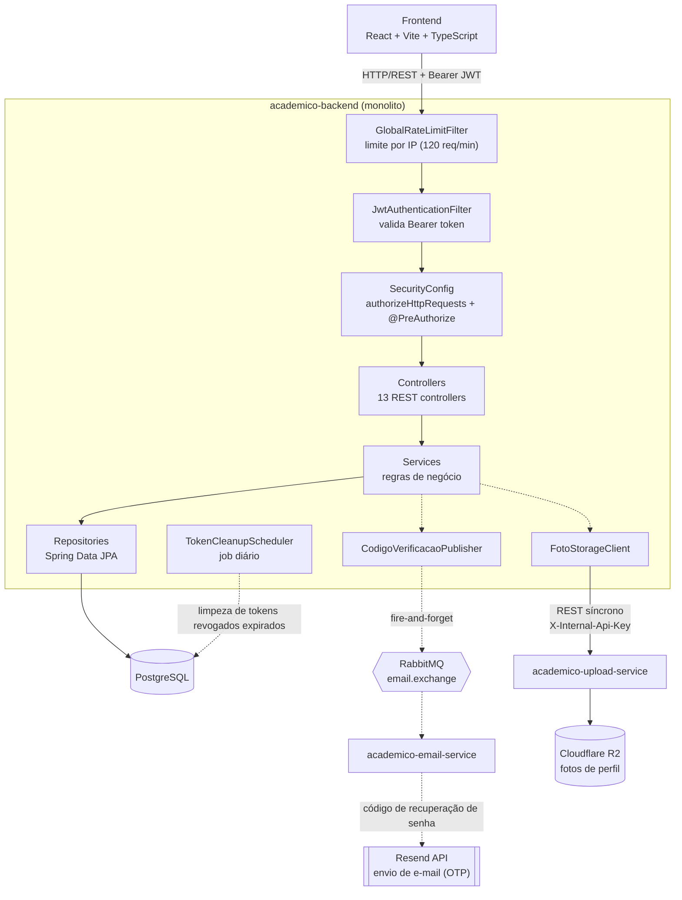

# Diagramas técnicos — Academico+

Diagramas de apoio ao TCC2, em Mermaid (renderiza nativamente no GitHub). Para colar no
documento do TCC, abra este arquivo no GitHub/VS Code e exporte a imagem renderizada de
cada bloco (ou use uma extensão de export Mermaid → PNG/SVG).

## Integrantes do grupo

- **Carlos Eduardo Viana Alves**
- **Jefferson Mateus Lima Silva**
- **Luana Maria Alves Caldas**
- **Maria Eduarda Viana Nascimento**
- **Vitor Manoel da Silva Costa**

**Orientador:** Professor(a) Pedro Alex

**Instituição:** Centro Universitário do Piauí (UNIFAPI)
**Curso:** Bacharelado em Ciência da Computação
**Data:** Junho de 2026

## Tema e escopo do projeto

**Tema:** Academico+ — Plataforma Digital para Fomento à Colaboração Interdisciplinar e
Networking Acadêmico.

O projeto nasce de um problema comum em instituições de ensino: alunos com competências
técnicas complementares (programação, design, gestão, redação, etc.) frequentemente não têm
como se descobrir mutuamente para formar equipes em projetos acadêmicos, iniciativas de
extensão ou trabalhos multidisciplinares. As formas atuais de busca — grupos de WhatsApp,
murais físicos, indicação boca a boca — não são pesquisáveis por habilidade nem guardam
histórico de colaboração. O Academico+ propõe resolver isso com uma plataforma web (MVP) que
mapeia competências dos alunos em forma de tags e centraliza projetos e oportunidades dentro
de uma mesma instituição, permitindo buscar pessoas e projetos por afinidade de habilidades.

O escopo do MVP está organizado em quatro fases funcionais:

1. **Autenticação & Perfis** — cadastro e login com JWT, perfis de usuário com tags de
   competências (`/usuarios/me/habilidades`) e upload de foto de perfil.
2. **Mural & Busca** — CRUD de projetos, candidaturas e equipe, com busca de projetos por
   texto e status.
3. **Recomendação** — ranking de projetos e candidatos por compatibilidade de habilidades
   (adaptação do Índice de Jaccard, com cobertura ponderada dos requisitos do projeto — ver
   README do backend para o detalhamento do algoritmo), incluindo sugestão de candidatos para
   o criador de um projeto.
4. **Reputação & Networking** — sistema de avaliação entre colegas que colaboraram no mesmo
   projeto (nota de 1 a 5 com comentário, liberado após o encerramento do projeto), denúncia
   de avaliação abusiva com resolução por administrador, e exclusão da própria conta em
   conformidade com a LGPD.

Ficam fora do escopo atual, por decisão consciente do grupo para manter o MVP viável dentro
do prazo do TCC: endosso de competências por professores, sistema de mensagens entre
usuários e diferenciação de permissões entre os papéis Aluno e Professor (hoje idênticas no
código). Arquiteturalmente, o sistema é um monolito em Spring Boot, com apenas duas partes de
menor acoplamento — envio de e-mail e upload de fotos — extraídas como microserviços por
razões didáticas (ver [decisão 9](./decisoes-arquiteturais.md#9-extração-de-e-mail-e-upload-como-microserviços-monolito-para-o-resto)).

## 1. Diagrama Entidade-Relacionamento

Construído a partir das migrações Flyway em
`academico-backend/src/main/resources/db/migration/` (schema versionado, `ddl-auto=validate` —
ver [decisões arquiteturais](./decisoes-arquiteturais.md), item 6) mais as entidades JPA para os
campos e relacionamentos completos.

## 2. Diagrama de casos de uso

Mermaid não tem notação UML de caso de uso nativa — a representação abaixo usa um grafo de
atores conectados às funcionalidades, agrupadas pela mesma área usada na tabela de endpoints
do README do backend. **Observação importante**: hoje `Aluno` e `Professor` têm exatamente as
mesmas permissões no código (nenhum endpoint distingue os dois papéis) — o papel `Professor`
existe no seed do banco (`niveis_acesso`) mas ainda não tem nenhum caso de uso próprio
implementado (ex.: endosso de competências, mencionado como fora do escopo atual no README do
backend). Isso está representado abaixo pelos dois atores levando às mesmas funcionalidades.

## 3. Diagrama de arquitetura

Expande o diagrama ASCII do README raiz, detalhando a cadeia de filtros de segurança do
monolito (a ordem importa: rate limit por IP roda **antes** da validação do JWT, então até uma
tentativa de flood em `/auth/**` sem token é barrada), os dois microserviços extraídos e as
integrações externas. Ver [decisão 9](./decisoes-arquiteturais.md#9-extração-de-e-mail-e-upload-como-microserviços-monolito-para-o-resto)
para o racional de por que só essas duas partes viraram serviço separado.

