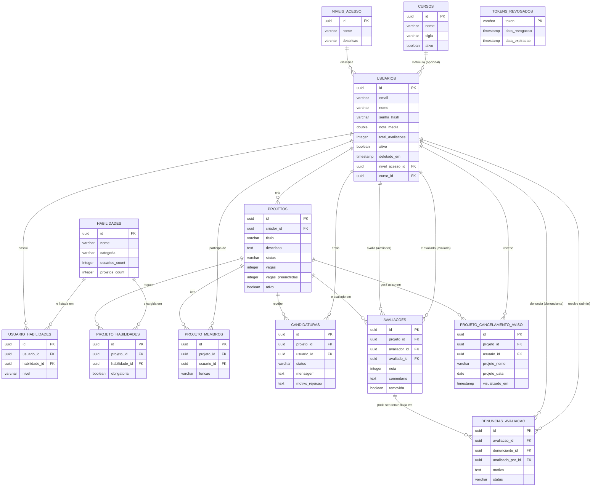
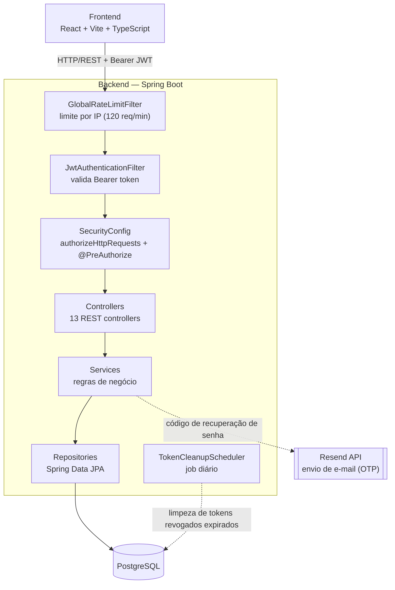

# Diagramas técnicos — Academico+

Diagramas de apoio ao TCC2, em Mermaid (renderiza nativamente no GitHub). Para colar no
documento do TCC, abra este arquivo no GitHub/VS Code e exporte a imagem renderizada de
cada bloco (ou use uma extensão de export Mermaid → PNG/SVG).

## 1. Diagrama Entidade-Relacionamento

Construído a partir de `academico-backend/src/main/resources/db/migration/V1_schema_inicial.sql`
mais as entidades JPA `Avaliacao` e `DenunciaAvaliacao`, que **não estão** nesse arquivo de
migração — hoje elas só existem porque `spring.jpa.hibernate.ddl-auto=update` as cria em tempo
de execução (ver [decisões arquiteturais](./decisoes-arquiteturais.md#6-flyway-declarado-mas-ddl-auto).
Isso é uma dívida técnica conhecida do projeto, não um erro deste diagrama.

## 2. Diagrama de casos de uso

Mermaid não tem notação UML de caso de uso nativa — a representação abaixo usa um grafo de
atores conectados às funcionalidades, agrupadas pela mesma área usada na tabela de endpoints
do README do backend. **Observação importante**: hoje `Aluno` e `Professor` têm exatamente as
mesmas permissões no código (nenhum endpoint distingue os dois papéis) — o papel `Professor`
existe no seed do banco (`niveis_acesso`) mas ainda não tem nenhum caso de uso próprio
implementado (ex.: endosso de competências, mencionado como fora do escopo atual no README do
backend). Isso está representado abaixo pelos dois atores levando às mesmas funcionalidades.

## 3. Diagrama de arquitetura

Expande o diagrama ASCII do README raiz, detalhando a cadeia de filtros de segurança (a ordem
importa: rate limit por IP roda **antes** da validação do JWT, então até uma tentativa de flood
em `/auth/**` sem token é barrada) e as integrações externas.

