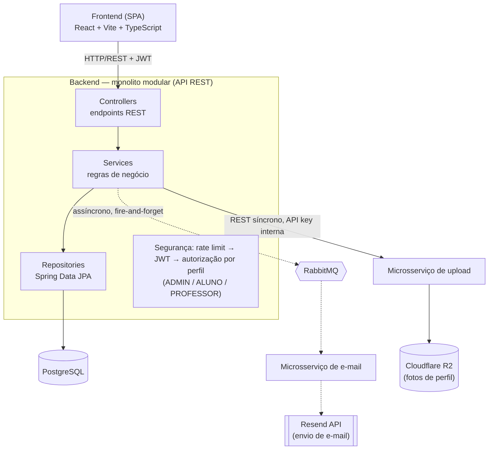

# Academico+ — Escopo e Arquitetura Inicial

Documento de apoio para orientação do TCC: integrantes do grupo, descrição geral do escopo do
projeto (com os requisitos funcionais) e o diagrama da arquitetura pensada inicialmente para o
sistema.

## Integrantes do grupo

- Carlos Eduardo Viana Alves
- Jefferson Mateus Lima Silva
- Luana Maria Alves Caldas
- Maria Eduarda Viana Nascimento
- Vitor Manoel da Silva Costa

**Orientador:** Professor(a) Pedro Alex
**Instituição:** Centro Universitário do Piauí (UNIFAPI)
**Curso:** Bacharelado em Ciência da Computação

## 1. Escopo do projeto

O **Academico+** é uma plataforma web pensada para resolver um problema comum dentro de
instituições de ensino: alunos com competências técnicas complementares (programação, design,
gestão, redação, etc.) frequentemente não têm como se descobrir mutuamente para formar equipes
em projetos acadêmicos, iniciativas de extensão ou trabalhos multidisciplinares. As formas hoje
usadas — grupos de WhatsApp, murais físicos, indicação boca a boca — não são pesquisáveis por
habilidade nem guardam histórico de colaboração.

A proposta é oferecer, em formato de MVP, uma plataforma que mapeia as competências dos alunos
em forma de tags de habilidades e centraliza projetos e oportunidades dentro da instituição,
permitindo buscar pessoas e projetos por afinidade de competências e acompanhar a reputação de
colaboração entre os próprios usuários.

### Requisitos funcionais

- Cadastro e autenticação de usuários (login com JWT)
- Perfil do usuário com foto, bio e tags de habilidades
- Mural de projetos com busca e filtros
- Criação, edição e encerramento de projetos
- Candidatura a projetos e gestão da equipe
- Aceite/rejeição de candidaturas pelo criador do projeto
- Recomendação de projetos e colaboradores por compatibilidade de habilidades
- Avaliação entre colegas que colaboraram no mesmo projeto
- Denúncia de avaliação abusiva, com resolução por administrador
- Painel administrativo (usuários, catálogo de habilidades, denúncias)

Ficam fora do escopo inicial, por decisão consciente do grupo para manter o MVP viável dentro
do prazo do TCC: endosso de competências por professores, sistema de mensagens entre usuários,
e diferenciação de permissões entre os papéis de Aluno e Professor.

## 2. Arquitetura pensada inicialmente

O sistema foi planejado como um **monolito modular** no backend (Spring Boot), com o
**frontend totalmente separado** (SPA em React), consumindo o backend exclusivamente via API
REST. Duas responsabilidades de menor acoplamento com o restante do domínio — envio de e-mail e
upload de fotos — foram planejadas como **microsserviços independentes** desde o início, por
serem partes isoladas (nenhuma dependência de repositório/entidade do domínio principal, um
único ponto de chamada cada), servindo também como exercício didático de arquitetura de
microsserviços dentro do TCC.

### Como se organiza

- **Frontend e backend totalmente separados**: o frontend é uma SPA em React que fala com o
  backend somente por HTTP/REST — não há renderização no servidor nem acoplamento de código
  entre as duas partes.
- **Backend como monolito modular**: um único serviço Spring Boot concentra controllers, regras
  de negócio e acesso a dados, evitando a complexidade operacional de um sistema totalmente
  distribuído — adequado ao porte e ao prazo de um TCC.
- **Dois microsserviços de apoio**: envio de e-mail (comunicação assíncrona via fila RabbitMQ,
  sem bloquear o fluxo principal) e upload de fotos (chamada síncrona autenticada por chave
  interna), escolhidos por terem baixo acoplamento com o domínio principal.
- **Banco de dados único** (PostgreSQL), acessado apenas pelo backend principal.
